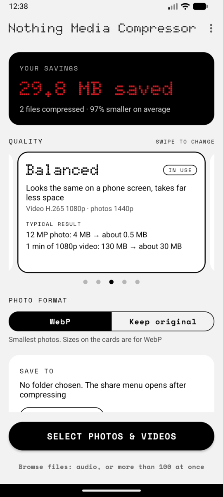
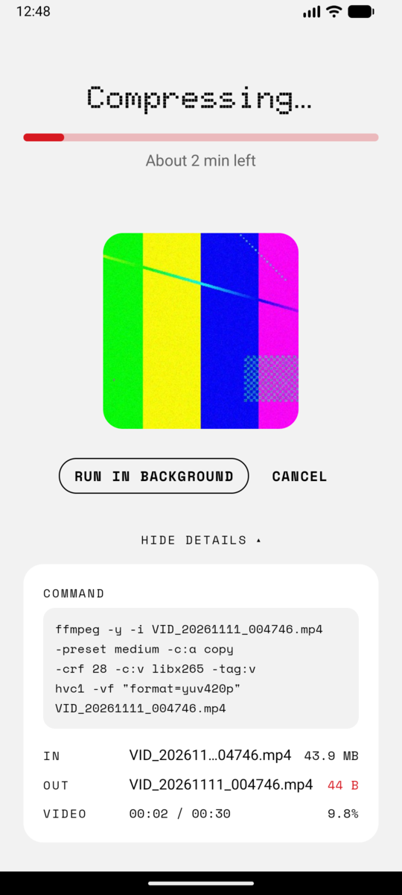
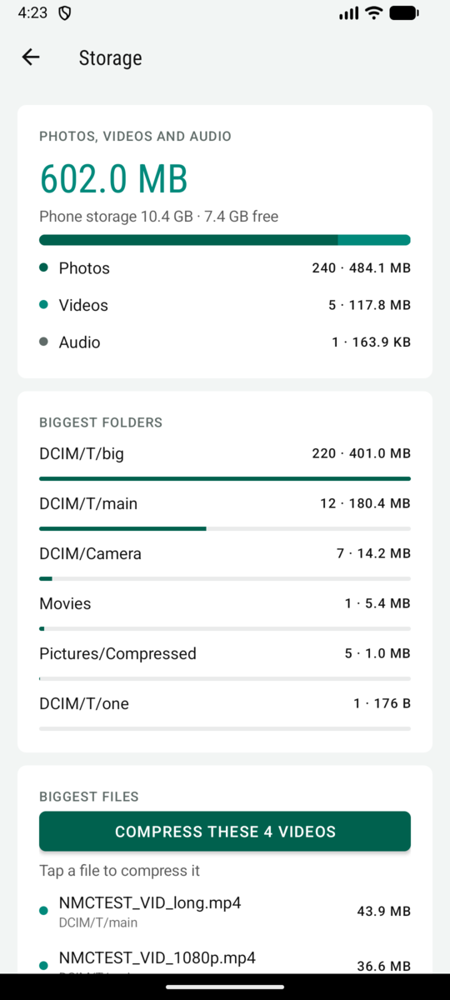
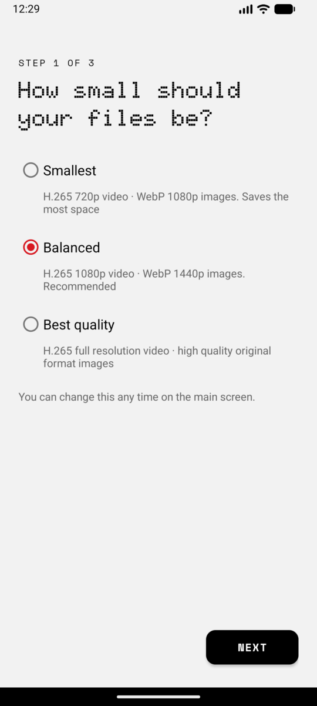
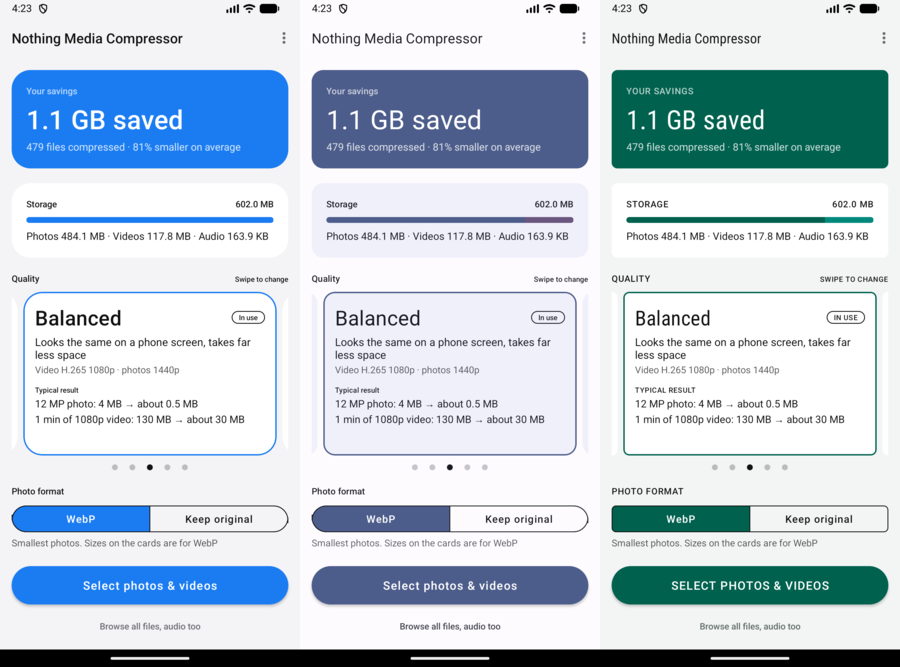

#  Nothing Media Compressor

Make photos and videos much smaller on your Android phone and get your storage back. A Nothing OS styled fork of [FFShare](https://github.com/caydey/ffshare).

<p align="left">
  
  
  
  
</p>

## What it does

- **Pick as many photos and videos as you like** (no limit: long-press one, then Select all), or share them straight from the gallery ("Compress & save" or "Compress & share"). "Browse all files" adds audio.
- **Swipe a quality card**: Ultra, Smallest, Balanced (recommended), Best quality or Custom. Every card shows a typical result.
- **Photo format**: WebP for the smallest files, or keep the original format (a JPEG stays a JPEG).
- **Saves to a folder you choose**, then offers to move the originals to the trash (kept there 30 days, with Undo). Works for files shared from Google Photos.
- **Keeps what matters**: the date taken and location, upright rotation, transparency in PNGs, and animation in GIFs. A file that would only get bigger stays as it is.
- **Big batches, in the background**: photos are compressed several at a time while videos take their own lane. Leave the screen any way you like, it keeps going with the screen off, shows progress in a notification and a banner on the home screen takes you back. Thousands of files show "Checking files" while they are sorted.
- **Fast video on real phones**: uses the phone's hardware encoder when it has one, and falls back to normal encoding automatically if the encoder fails or hangs.

- **Storage tracker**: how much space photos, videos and audio take, the biggest folders and the biggest files. Tap a file, or "Compress these videos", to shrink them right there.

<p align="left">
  
</p>

## Looks

Five themes in Settings → Theme:

- **Nothing** (default): monochrome with one red accent, dot-matrix headlines ([Doto](https://fonts.google.com/specimen/Doto)) and monospace labels ([Space Mono](https://fonts.google.com/specimen/Space+Mono)).
- **One UI style**: system font (One UI Sans on Samsung phones), sentence case, very round cards, blue.
- **Material You**: Android's own look, colours from your wallpaper on Android 12+.
- **Midnight**: pure black for OLED screens, monospace, green accent.
- **Classic**: the original FFShare teal.

All of them follow light and dark mode (Midnight is always dark). The launcher icon has a monochrome layer for themed icons.

<p align="left">
  
  
</p>
<p align="left">
  
</p>

## Building

The FFmpeg library is prebuilt in `app/libs` (arm64 with MediaCodec), so a normal Android build works:

```sh
./gradlew :app:assembleDebug
```

To rebuild FFmpeg itself, run `./build_ffmpegkit.sh` (needs Nix).

Debug builds can start a batch for a whole folder from adb, handy for testing:

```sh
adb shell pm grant com.caydey.ffshare.plus android.permission.READ_MEDIA_IMAGES
adb shell am start -a android.intent.action.SEND_MULTIPLE --es debug_folder DCIM/Test/ -n com.caydey.ffshare.plus/com.caydey.ffshare.CompressAndShare
```

The app id is `com.caydey.ffshare.plus`, so it installs next to the original FFShare.

## Credits and license

- [FFShare](https://github.com/caydey/ffshare) by caydey, the app this is built on
- [Scrambled-Exif](https://gitlab.com/juanitobananas/scrambled-exif) by juanitobananas, which inspired the original
- [ffmpeg-kit-next](https://github.com/arthenica/ffmpeg-kit-next) by arthenica, the FFmpeg library
- [Timber](https://github.com/JakeWharton/timber)
- Fonts Doto and Space Mono, SIL Open Font License

GPL-3.0, like FFShare. See [LICENSE](LICENSE). Not affiliated with Nothing Technology.
